<!-- ░▒▓ HEADER ▓▒░ -->
<p align="center">
  
</p>

<p align="center">
  
</p>

<p align="center">
  <a href="https://ani2215.github.io"></a>
  <a href="https://www.linkedin.com/in/sri-mukha-n-510aa6223/"></a>
  <a href="mailto:anikethnallani2@gmail.com"></a>
</p>

<p align="center">
  
  
  
  
  
</p>

<p align="center">
  
</p>

<!-- ░▒▓ ABOUT ▓▒░ -->
## `> cat about_me.json`

<table>
<tr>
<td width="50%" valign="top">

```json
{
  "name": "Aniketh",
  "role": "Data Analyst / Data Engineer",
  "xp": "5.5 years",
  "builds": [
    "ETL pipelines (1M+ rows)",
    "dashboards execs actually open",
    "prediction models",
    "AI agents"
  ],
  "impact": "-45% manual work",
  "currently_building": "AI ERP for small biz",
  "fuel": ["coffee", "more coffee"],
  "side_quests": ["Xbox", "anime",
                  "movies", "web dev"]
}
```

</td>
<td width="50%" valign="top">

**🧠 What I actually do**

- 🏗️ Build **ETL pipelines** on AWS & Oracle that move **million-record** finance, vendor and customer data
- ⚙️ Kill repetitive work with Python + SQL: **−45% manual effort**
- 📊 Ship **Power BI & Tableau** dashboards that drive decisions
- 🔮 Train **forecasting models** and validate them honestly
- 🤖 Build **LLM agents** that turn messy text into clean database rows
- 🎓 M.S. Computer Science, Stevens Institute of Technology

</td>
</tr>
</table>

<p align="center">
  
  
</p>

<!-- ░▒▓ STACK ▓▒░ -->
## `> ls ~/arsenal`

<p align="center">
  
</p>

<table align="center">
<tr><td><b>📊&nbsp;VIZ</b></td><td>


</td></tr>
<tr><td><b>🏗️&nbsp;DATA&nbsp;ENG</b></td><td>


</td></tr>
<tr><td><b>☁️&nbsp;CLOUD</b></td><td>


</td></tr>
<tr><td><b>🤖&nbsp;AI/ML</b></td><td>


</td></tr>
<tr><td><b>🗄️&nbsp;MORE</b></td><td>


</td></tr>
</table>

<!-- ░▒▓ PROJECTS ▓▒░ -->
## `> ./run --featured-projects`

<table>
<tr>
<td width="50%" valign="top">

### 🤖 AI ERP for Small Businesses
Orders, inventory and invoicing in one system. An AI assistant creates orders from plain-text messages and flags low stock before it runs out.

`Python` `PostgreSQL` `LLM agents` `React`


</td>
<td width="50%" valign="top">

### 🏗️ Batch Pipeline & Warehouse
Daily ingestion of a large public dataset into a star-schema warehouse, with data quality checks on every run.

`Airflow` `PySpark` `Snowflake` `dbt`


</td>
</tr>
<tr>
<td width="50%" valign="top">

### 📨 Messages → Database
NLP that turns free-text order messages into validated rows, deleting hours of manual data entry every week.

`Python` `NLP` `PostgreSQL`


</td>
<td width="50%" valign="top">

### 🔮 Prediction Model + Live App
A forecasting model benchmarked against a baseline and deployed as an app anyone can play with.

`scikit-learn` `Pandas` `Streamlit`


</td>
</tr>
</table>

<p align="center"><b>🎛️ Live interactive dashboards → <a href="https://ani2215.github.io">ani2215.github.io</a></b></p>

<!-- ░▒▓ STATS ▓▒░ -->
## `> SELECT * FROM my_github;`

<p align="center">
  
</p>

<p align="center">
  
  
</p>

<p align="center">
  
</p>

<!-- Contribution snake: generated daily by .github/workflows/snake.yml -->
<p align="center">
  
</p>

<!-- ░▒▓ FOOTER ▓▒░ -->
<p align="center">
  
</p>

<p align="center">
  
  <br/>
  
</p>


